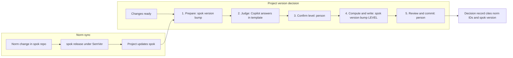

**Created:** `2026-10-27`
**Linked:** `—`
**Status:** `draft`
**Related-epic:** `—`
**Related-branch:** `—`

# spok — Splor Kit for shared version decisions

## 1. Context and motivation

The presentation "SDD assistido por IA — Semantic Versioning" (`slides/20261028_sdd_semver.md`, [issue #18](https://github.com/splor-mg/apresentacoes/issues/18), 2026-10-28) argues that a version number communicates something only when whoever publishes and whoever consumes share the rule. Without the rule, `1.7.3` is a label; with it, a contract. The presentation closes with a proposal: carry the team's version rule inside a package, called **spok** (Splor Kit), and let the AI assistant available at work help apply it.

**Observed facts (2026-10-27):**

- The team already publishes versioned Python packages. `dpetl` has 27 releases on PyPI; the latest is `0.18.4`.
- In the local clones checked, `classificador-receita` and `siop-mg` declare `0.1.0` in `pyproject.toml`, keep no `CHANGELOG` at the root, and carry no Git tags.
- `classificador-receita` declares two different numbers for two artifacts: `0.1.0` for the Python project and `1.0.0` in `datapackage.yaml`.
- The AI assistant available at work is Microsoft Copilot (operator statement).
- The model that inspired spok — one triple of norm, template, and agent per domain, plus command-line tools that apply it — exists only in Carlos's personal environment (`specs-catalog`, `toolkit`). Neither is available at work.
- The probable rule baseline is the VERSION section of an archived rule set in that personal toolkit (`tag-version_rules.md`), with IDs `VERSION-01-01-01` to `VERSION-01-05-02`. The tag rules of the same file are excluded (operator statement).

**Problem.** Without a shared rule, the same set of changes can receive different levels in different repositories, and numbers stay at `0.1.0` or diverge between artifacts of one repository, as the clones above show. An assistant consulted without the team's rule answers with generic SemVer knowledge and cannot cite a team norm. Rules copied by hand from repository to repository tend to drift apart.

**Assumed, not yet observed:** that no written version rule exists at team level beyond individual judgment, that the team wants a shared rule, and that Copilot answers consistently when it receives the rule together with the facts. Section 8 lists these assumptions.

**Why now.** The presentation gives the team a common vocabulary: contract, public interface, the largest impact wins, a published number is never reused. A concrete proposal can be discussed while that vocabulary is fresh.

---

## 2. Vision and purpose

Every splor-mg repository that publishes a versioned artifact follows the same written version norm, carried by one package that the repository declares as a development dependency.

A version decision becomes:

- **explainable** — the level cites the norm IDs that justify it;
- **reproducible** — the next number is computed from the current one and the level, never typed;
- **owned** — a person accepts the level and commits the result.

Microsoft Copilot contributes judgment under the team's norm instead of generic advice. The norm itself evolves under the SemVer it teaches: changing the norm means releasing a new spok version, and projects receive it by updating a dependency.

Guiding principle: **the AI judges, the script computes, the person decides.**

---

## 3. Objectives

**Primary**

- Provide a package, spok, that carries the `version` domain as a triple — norm, template, agent — and supports one decision cycle: prepare the context for Copilot, then apply the level the person accepts.

**Supporting**

- Make norm synchronization a dependency update: projects receive norm changes by updating spok, not by copying text.
- Version spok itself under SemVer, starting in the `0.y` series with a written promise, so every norm change carries an explicit compatibility signal.
- Leave a decision record for each version decision: previous version, new version, baseline, classification, justification, and the spok version in force (provisional `VERSION-01-05-02`).
- Keep the version decision separate from tagging, release, and publication (provisional `VERSION-01-05-01`).
- Keep the mechanism open to further domains once `version` proves useful.

---

## 4. Conceptual scope

### In scope

- SemVer decision support for one repository at a time: MAJOR, MINOR, PATCH, pre-release identifiers, the `0.y.z` series, and the whole set of changes since the previous version.
- A context bundle in plain text, readable by a person, meant to be pasted into Copilot.
- Computing the next version and updating the version the project declares. Whether spok also closes the changelog release section is open (section 10).
- The decision record.
- The versioning of spok itself, and the synchronization of the norm through spok releases.
- Audiences: team members who publish versions, starting with Python packages; maintainers of the norm.

### Out of scope

- Creating tags, GitHub releases, package publications, or deployments. Tag rules are also out of the first domain, as decided for the 2026-10-28 presentation.
- Calling an AI service programmatically. spok never sends data anywhere by itself.
- Domains other than `version` in the first stages, such as commits or changelog.
- Any dependency on Carlos's personal `specs-catalog` or `toolkit`.
- Mandatory enforcement in CI. spok aids a decision; it does not gate a merge.

---

## 5. High-level requirements

### Functional expectations

One version decision would be operated in five steps. Command names are the working names shown in the 2026-10-28 presentation: `spok version bump` without a level prepares, and with a level applies. Final names belong to the public interface declared in Stage 4.

Norm IDs below come from the archived rule set and are **provisional** until the norm is agreed (section 10).

#### Step 1 — Prepare (spok)

- **Why it exists:** the level depends on everything that changed since the previous version, not on the last commit (`VERSION-01-02-04`). Copilot can only judge what it receives.
- **Who operates:** the person closing a delivery runs `spok version bump` in the repository.
- **Input:** the version the project declares, the reference point of the previous version, the changes since then (commit subjects, and changelog notes when they exist), and the `version` triple.
- **Output:** one plain-text bundle — agent instructions, the norm, the answer template, and the repository facts — copied so it can be pasted. The repository does not change (`VERSION-01-05-01`).
- **When something is missing:** the bundle states the gap instead of guessing. If the project has not named its public interface, the bundle says so, and the agent tells Copilot to ask before classifying (`VERSION-01-01-02`).

#### Step 2 — Judge (Copilot)

- **Why it exists:** classifying changes is judgment. The norm makes that judgment explainable and comparable across repositories.
- **Who operates:** the person pastes the bundle into Microsoft Copilot; Copilot answers.
- **Input:** the bundle.
- **Output:** an answer that fills the template — the level, each norm ID that justifies it with a one-line reason, and the exact apply command, such as `spok version bump minor`. Copilot may ask for missing facts instead of answering.
- **Norms involved:** `VERSION-01-02-01` to `VERSION-01-02-03` (MAJOR, MINOR, PATCH), `VERSION-01-02-04` (whole set of changes), `VERSION-01-02-05` (the `0.y.z` series), `VERSION-01-03-01` and `VERSION-01-03-02` (pre-release stage and target).
- **When it goes wrong:** an answer outside the template, or without IDs, is not used. The person asks again or decides with the norm alone.

#### Step 3 — Confirm the level (person)

- **Why it exists:** Copilot's level is advice. The person who publishes owns the decision.
- **Who operates:** the person reads the cited norms and accepts or overrides the level.
- **Output:** the level to apply and, on override, the person's reason.
- **Norms involved:** `VERSION-01-05-02` (record the decision).
- **When it goes wrong:** a disagreement is not a failure. It is the signal that calibrates the norm, and the record keeps it (Stage 3).

#### Step 4 — Compute and write (spok)

- **Why it exists:** arithmetic is not judgment. The next number must follow from the current number and the level, every time.
- **Who operates:** the person runs `spok version bump <level>`.
- **Input:** the current version, the accepted level, and an optional pre-release intent.
- **Output:** the next version under SemVer rules — PATCH reset on MINOR (`VERSION-01-02-02`), pre-release ordering (`VERSION-01-03-03`), no precedence for build metadata (`VERSION-01-03-04`) — written where the project declares its version, together with the decision record. A preview without changes is available.
- **When it goes wrong:** a computed version that was already published is refused (`VERSION-01-04-01`).

#### Step 5 — Review and commit (person)

- **Why it exists:** deciding a version is not publishing it (`VERSION-01-05-01`).
- **Who operates:** the person reviews the change and commits it. Tagging, release, and publication stay separate acts, outside spok.
- **Output:** one commit with the new version and its record. Release notes that state scope and compatibility remain the person's responsibility (`VERSION-01-04-03`).
- **When it goes wrong:** before publication, a wrong decision is undone by repeating the cycle. After publication, the correction is a new version (`VERSION-01-04-01`).

#### Norm evolution and synchronization

- A norm change happens in the spok repository and is classified with the same rules: a new compatible norm is MINOR; a change that makes earlier valid decisions invalid is MAJOR; a wording fix that keeps the meaning is PATCH.
- Each project declares the spok version it follows, like any other dependency. Updating spok is how a project receives a new norm.
- Each decision record names the spok version in force, so a past decision can be read against the norm that applied when it was made.
- spok decides its own versions with its own cycle.

### Quality and policy expectations

- **Determinism:** the same inputs produce the same bundle and the same next version.
- **Transparency:** the bundle is plain text that the person can read before pasting. Nothing reaches Copilot that the person did not see.
- **Data care:** the bundle carries only the facts the decision needs — versions, commit subjects, changelog notes — and never credentials or environment contents.
- **Human in the loop:** spok never commits, tags, pushes, or publishes, and never contacts an AI service.
- **Light adoption:** spok installs as a development dependency, keeps its own dependencies few, and does not change how projects build or publish.
- **Portability:** spok runs on the machines the team uses; which environments those are is open (section 10).

---

## 6. Macrocomponents

### Norm catalog — the `version` triple

Holds the **norm** (rules with stable IDs, each with a strength of MUST, SHOULD, or MAY, a reason, and an example), the **template** (the shape of Copilot's answer and the fields of the decision record), and the **agent** (Copilot's role: read the facts, apply the norm, fill the template, ask when a fact is missing). It is the source for the context builder and is versioned with spok.

### Context builder

Reads the repository facts that a decision needs and assembles them with the triple into the bundle. It only reads; it changes nothing.

### Version calculator and writer

Computes the next version from the current one and the accepted level, updates the version the project declares, writes the decision record, and refuses to reuse a published version. It never judges a level on its own.

### Copilot channel

The path between the bundle and Copilot's answer. Today it runs through a person, by copy and paste. Other channels — a terminal agent reading the agent text as a skill, or repository instructions for GitHub Copilot — would reuse the same agent text without changing the norm.

### Distribution and synchronization

The spok repository in splor-mg, its releases, and the way projects install and pin it. This component turns "sync the norm" into "update a dependency". The distribution name is open, because `spok` is taken on PyPI (section 8).

### Norm governance

Who proposes, reviews, and approves norm changes; how each change is classified as MAJOR, MINOR, or PATCH of spok; and how decision records and overrides feed calibration.

---

## 7. Evolution stages

### Stage 1 — Agreed norm on paper

- **Outcome:** the `version` triple exists as text: norm, template, and agent. Baseline: the VERSION section of the archived rule set, without tag rules.
- **Operation:** Carlos drafts the triple and the team reviews it. The triple is exercised by hand: a person gathers the facts of past releases, for example from `dpetl`'s release history, pastes them with the triple into Copilot, and compares the answers with what was decided at the time.
- **Versioning:** no package yet. The triple is a draft; its first released form is spok `0.1.0`.
- **Evidence:** on sample cases, reviewers judge Copilot's levels and cited IDs sound.

### Stage 2 — Minimal kit, `0.1.0`

- **Outcome:** spok exists in a splor-mg repository, carries the triple, and supports the cycle: prepare, apply, record.
- **Operation:** one pilot repository installs spok as a development dependency and closes a real version through the cycle. spok's own next version is decided the same way.
- **Versioning:** first release `0.1.0`, with the `0.y` promise written: what may change between `0.y` releases (provisional `VERSION-01-02-05`).
- **Evidence:** one real version decided, recorded, and committed through the cycle in the pilot.

### Stage 3 — Pilot and calibration, `0.y`

- **Outcome:** the norm and the agent are calibrated by real decisions, and known gaps are written down.
- **Operation:** a few repositories use spok across real releases: at least one Python package, and data packages if the scope question allows. Overrides kept in decision records are reviewed and turned into norm changes or documented exceptions.
- **Versioning:** refinements to the norm and to the tool ship as `0.y` releases; projects update spok to receive them.
- **Evidence:** decision records across repositories; overrides that led to norm changes; a version closed by someone other than the author.

### Stage 4 — Stable contract, `1.0.0`

- **Outcome:** spok declares its public interface: commands and options, norm IDs and their meaning, and the formats of the template and the bundle.
- **Operation:** spok becomes the team reference for repositories that publish versions. Norm changes follow the governance agreed for the norm.
- **Versioning:** `1.0.0`. From then on, MAJOR, MINOR, and PATCH of spok follow the impact of each change on the decisions of the projects that use it.
- **Evidence:** the declared public interface, and repositories pinned to the `1.x` line.

### Stage 5 — Beyond version

- **Outcome:** further domains, such as commits or changelog, become triples under the same mechanism. Other channels join if they become available at work.
- **Operation:** the same cycle shape: the kit prepares the context, the AI judges, the kit applies, the person decides.
- **Versioning:** each new domain is a compatible addition, a MINOR of spok.
- **Evidence:** a second domain used in a pilot repository.

---

## 8. Assumptions and constraints

### Assumptions

- **No written version rule exists at team level today.** If false, spok should carry that rule instead of a new one.
- **Institutional policy allows pasting repository facts into Microsoft Copilot:** versions, commit subjects, changelog notes. If false, the bundle must shrink or be anonymized, or the person judges with the norm alone while spok only computes and records.
- **Team Python projects use Poetry and declare their version in `pyproject.toml`.** If false, spok must recognize other version declarations before the pilot.
- **The team accepts a written norm with IDs as the reference for version decisions.** If false, spok shrinks to a calculator, and the premise of the presentation does not hold.
- **Copilot follows the template when the agent text asks it to.** If false, answers need manual reading; the cycle still works because the person decides, but records lose consistency.
- **The VERSION section of the archived rule set is the baseline** (operator statement, 2026-10-27). If false, the content of the triple changes; the mechanism does not.
- **A splor-mg repository can host spok, and team machines can install it.** If false, distribution needs another route before Stage 2.

### Constraints

- **Name:** `spok` is registered on PyPI by an unrelated project ("Space Plasmas Observations Kit", version `0.1.1`, checked 2026-10-27). A PyPI distribution needs another name; `splor-kit` was not registered on that date. The command can still be called `spok`.
- **Channel:** Copilot is reachable only through its chat interface. Every exchange between spok and Copilot passes through a person.
- **No publication:** spok must not commit, tag, push, or publish. Tag rules stay out of the first domain.
- **Self-contained at work:** spok must not depend on the personal `specs-catalog` or `toolkit`.
- **Stable IDs:** a norm ID cited in a decision record keeps its meaning once published. It is the address of the rule, not a version number.

---

## 9. Success criteria

- In pilot repositories, every version decision after adoption has a decision record with the previous and new version, the level, the cited norm IDs, the justification, and the spok version. Evidence: the records themselves.
- Copilot's level matches the level the person applies in most decisions, and every override carries a reason. Overrides lead to norm changes or documented exceptions. Evidence: the records and spok's own release history. The agreement target is set when the work is planned.
- After adoption, no version number in a pilot repository is typed by hand. Evidence: each version in the history has a matching record.
- A norm change released in spok reaches the pilot repositories through a spok update, with no text copied. Evidence: the pinned spok versions and the records that cite them.
- Someone other than the author completes the cycle unaided. Evidence: a record by another team member.
- spok never creates a tag and never publishes. Evidence: no such operation in spok's behavior or history.

---

## 10. Open questions

- **Norm set:** which rules will spok carry? The expected baseline is the VERSION section of `tag-version_rules.md`; Carlos will provide the final set.
- **ID collision:** the catalog law synced into this repository (`_dev/.specs/.spec_version.md`) already uses `VERSION-NN-00-00` IDs for SDD process rules, for example `VERSION-02-00-00` for classification, while the presentation cites `VERSION-01-02-02` from the archived set. Should spok keep the `VERSION` prefix and renumber, or use another prefix?
- **Language of the triple:** Portuguese for the team, English as in the catalog language matrix, or both?
- **Distribution:** publish on PyPI under another name, for example `splor-kit`, or install from the splor-mg Git repository?
- **Which Copilot:** Microsoft 365 Copilot Chat, or GitHub Copilot in VS Code, which can also read repository instructions? The answer changes the channel options, not the norm.
- **Previous version:** what marks "the previous version" in a repository without tags or changelog: the declared version, the commit that last changed it, or something else?
- **Changelog:** does spok close the changelog release section, or only update the version and write the decision record?
- **Data packages:** are data packages (`datapackage.yaml`) in scope for the first stages? If so, what is a data package's public interface: its schema? `classificador-receita` declares `1.0.0` there and `0.1.0` in `pyproject.toml`.
- **Governance:** who owns the norm, who reviews changes, and how soon are projects expected to update spok?
- **Decision record:** where does it live: in the changelog entry, in the commit body, or in its own file?
- **Clipboard:** do team machines (Windows, WSL) support copying the bundle, or is printing it enough?
- **Pilot:** which repositories pilot spok in Stages 2 and 3?

---

## References

**Authoritative**

- [Issue #18, splor-mg/apresentacoes](https://github.com/splor-mg/apresentacoes/issues/18): "Criar apresentação sobre Semantic Versioning - SDD assistido por IA". Local store: `_dev/gh/issues/open/0018_Criar-apresentacao-sobre-Semantic-Versioning-SDD-assistido-por-IA.yml`.
- `slides/20261028_sdd_semver.md`: the 2026-10-28 presentation; its "Proposta" section introduces spok.
- [Semantic Versioning 2.0.0](https://semver.org/spec/v2.0.0.html).
- [Keep a Changelog 1.1.0](https://keepachangelog.com/en/1.1.0/).
- `_dev/.specs/.spec_concep.md` and `_dev/.tmpl/.tmpl_concep.md`: law and layout of this file.

**Exploratory**

- `tag-version_rules.md`, VERSION section: archived rule set in Carlos's personal `toolkit` (`_dev/.archive/`), source of the provisional IDs.
- [specs-catalog](https://github.com/carloshob/specs-catalog): norm, template, and agent triples per domain, the model for spok's catalog. Personal; not available at work.
- `_dev/.specs/.spec_version.md`: catalog VERSION law synced into this repository; process rules under a different ID scheme.
- [CalVer](https://calver.org/) and [ZeroVer](https://0ver.org/): alternative schemes compared in the presentation.
- [dpetl on PyPI](https://pypi.org/project/dpetl/): team package with 27 releases on 2026-10-27.
- [spok on PyPI](https://pypi.org/project/spok/): unrelated project holding the name.
