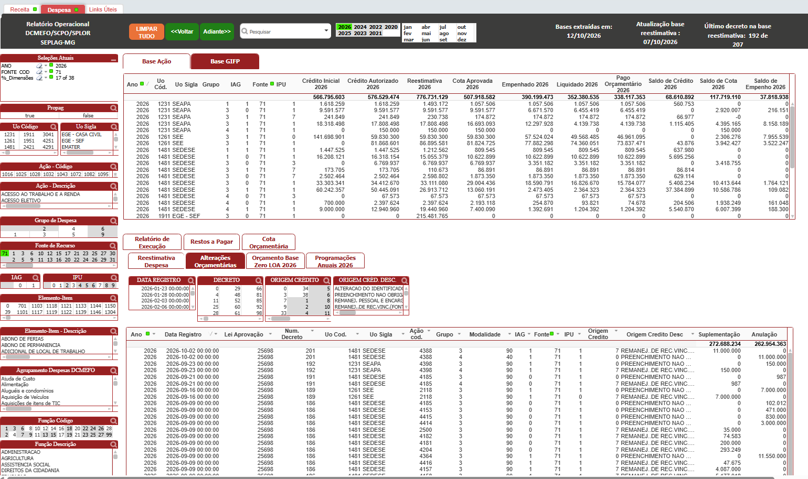

---
slides:
  title: Relacionamento de Bases de Dados - Linktable
  theme: dracula
revealjs:
  width: 1920
  height: 1080
---

<style>
.reveal pre code { max-height: 900px; white-space: pre-wrap !important; overflow-wrap: anywhere; }
</style>

<div class="r-hstack" style="align-items:flex-start; gap:80px">
<div style="flex:1">

#  Relacionamento de Bases de Dados

## método _Linktable_

<!--s-->

## Contexto

👉 [ETL é o caminho que o dado percorre até se tornar informação útil](https://splor-mg.github.io/apresentacoes/20260701_etl.html?showNotes=true#/1).

- _O óbvio precisa ser dito_.
- Integrar dados de diferentes fontes para aprimorar a _tomada de decisão_.
- Um processo mecânico (automatizado ou não).
- Não envolve análise de dados.
- [Acrónimo](https://pt.wikipedia.org/wiki/Acr%C3%B3nimo):
  - _Extract (Extrair)_:
    - Tirar os dados de onde eles vivem.
    - Os dados são lidos, não alterados.
    - Se a extração falhar, todo o ETL falha.
  - _Transform (Transformar)_: Tratar, padronizar e enriquecer os dados.
  - _Load (Carregar)_: Armazenar os dados prontos em um destino final (análise de dados e tomada de decisão).

<!--s-->
## Proposta

<div class="r-hstack" style="align-items:flex-start; gap:80px">
<div style="flex:1">

- Repositório [dados-orcamentarios](https://github.com/splor-mg/dados-orcamentarios):
  - schemas + scripts + workflow.

- Repositório do datapackage:
  - dados processados + descriptor (datapackage.json).

- [dpetl](https://github.com/splor-mg/dpetl)
  - `dpetl_extract`.
  - `dpetl_transform`.
  - `dpetl_load`.

</div>
<div style="flex:1">

- Datamart
  - Banco de dados único com todos os dados orçamentários.

- Plataforma de visualização de panéis
  - Abandono do _Qlikview_.
  - Observable?

</div>
</div>

<!--s-->

## Relatório Operacional

- Painel de Dados.
- Agrega dados hisóricos e atualizados.
- Universo SIAFI, SIAD e da reestimativa de receitas e despesas.
- Construido em R usando o Qlikview para visualização.

<!--v-->




<!--s-->

## O Desafio da Modelagem

<pre>
Computação / Sistemas de Informação
        │
        └── Banco de Dados
              │
              ├── Modelagem de Dados
              │     ├── Modelo Relacional
              │     ├── Normalização
              │     └── Modelagem Dimensional
              │            ├── Tabelas Fato
              │            ├── Tabelas Dimensão
              │            ├── Star Schema
              │            └── Snowflake Schema
              │
              ├── Data Warehouse
              ├── Data Mart
              ├── Business Intelligence (BI)
              └── Engenharia de Dados

</pre>

A modelagem dimensional é uma técnica de modelagem de dados criada especificamente para ambientes analíticos, que organiza os dados em duas categorias: **fatos** e **dimensões**.

<!--s-->

## **fatos** e *dimensões*

### Quanto foi gasto por unidade orçamentária em cada mês ?

- o **fato**: que é o gasto.
- as *dimensões*: que descrevem o gasto (unidade orçamentária, elemento de despesa, ação, etc)

A ideia central é separar _o evento que aconteceu_ do _contexto que explica esse evento_.

<!--s-->

## Dimensões Compartilhadas e granularidades distintas
<div class="r-hstack" style="align-items:flex-start; gap:80px">
<div style="flex:1">

#### _receita_
---------
- ano
- mês
- uo
- fonte

`+`
métricas numéricas
</div>
<div style="flex:1">

#### _execução_
---------
- ano
- mês
- uo
- ação
- elemento

`+`
métricas numéricas
</div>

<div style="flex:1">

#### _crédito_
---------
- ano
- mês
- uo
- ação

`+`
métricas numéricas

</div>
</div>

<!--s-->
## Linktable com múltiplas chaves

- É uma tabela intermediária que permite relacionar diversas tabelas fato contendo dados agrupados em diferentes dimensões e granularidades.
- O nome _linktable_ é o nome dado pelo Qlik para essa técnica, também chamada de Bridge Table, Junction Table, Fact Constellation,  Galaxy Schema dentre outros.

<!--v-->

## Construção da Linktable
___

1. Separar dimensões de fatos.
2. Empilhar dimensões, excluindo duplicadas.
3. Construir chaves técnicas.
4. Construir a Link Table.
5. Associar as chaves às tabelas fato.


<!--v-->
<div class="r-hstack" style="align-items:flex-start; gap:80px">
<div style="flex:1">
receita

    === "**Antes**"

        | ano  | mês | uo    | fonte | valor  |
        | ---- | --- | ----- | ----- | ------ |
        | 2026 | 03  | 2061 | 60    | 100000 |

    === "**Após a criação das chaves**"

        | k_receita | valor  |
        | --------- | ------ |
        | "| 2026 | 03 | 2061 | 60 | null | null |" | 100000 |

execucao

    === "**Antes**"

        | ano  | mês | uo    | ação | elemento | valor  |
        | ---- | --- | ----- | ---- | -------- | ------ |
        | 2026 | 03  | 2061 | 20RK | 339030   | 150000 |

    === "**Após a criação das chaves**"

        | k_execucao | valor  |
        | ---------- | ------ |
        | "2026 | 03  | 2061 | null  | 20RK | 339030" | 150000 |
</div>

<div style="flex:1">
credito

    === "**Antes**"

        | ano  | mês | uo    | ação | valor |
        | ---- | --- | ----- | ---- | ----- |
        | 2026 | 03  | 2061 | 20RK | 80000 |

    === "**Após a criação das chaves**"

        | k_credito | valor |
        | --------- | ----- |
        | "2026 | 03 | 2061 | null | 20RK | null" | 80000 |
</div>
</div>
<!--v-->

*Linktable*

    === "**Resultado**"
      | ano  | mês | uo    | fonte | ação | elemento | k_receita         | k_execucao         | k_credito         |
      | ---- | --- | ----- | ----- | ---- | -------- | ----------------- | -----------------  | ----------------- |
      | 2026 | 03  | 2061 | 60    | null | null     | "| 2026 | 03 | 2061 | 60 | null | null |" | null | null     |
      | 2026 | 03  | 2061 | null  | 20RK | 339030   | null | "2026 | 03  | 2061 | null  | 20RK | 339030"  | null  |
      | 2026 | 03  | 2061 | null  | 20RK | null     | null | null  | "2026 | 03 | 2061 | null | 20RK | null"      |

<!--v-->

## Considerações

- É o melhor modelo? Não sei! 🤡
> (...) construir uma modelagem dimensional e relacionar diversas tabelas fato contendo dados agrupados em diferentes dimensões, ou granularidades, não é uma tarefa nada trivial, correspondendo a uma das tarefas mais importantes, senão a mais importante dentro as atividades para construção de um painel de relatórios em BI. Isto porque não há uma regra ou fórmula única a se seguir. Cada projeto exige análise e estudo individualizados. [Relacionamento das bases no relatório operacional: método Concatenate x Linktable](https://splor-mg.github.io/notas/main/20231804T160439/#introdu%C3%A7%C3%A3o)

- Prioridade do momento: reproduzir o modelo usando Python, os datapackages do dados_orcamentários, o novo processo de ETL, abandonar a visualização pelo Qlik, etc.

<!--s-->

## Dpetl e linktable :purple_heart:

<!--s-->

<div class="r-hstack" style="align-items:flex-start; gap:80px">
<div style="flex:1">

## Package Linktable
- Contrói uma linktable dentro de *um único datapackage* a partir dos seus recursos cuja configuração estejam como `package_linktable: true`.
- Construção ocorre junto com o processo do `dpetl tranform`.
```
yaml
dpetl_transform:
      path: data_pre
      format: csv
      package_linktable:true
```
- As tabelas fato e a linktable gerada é salva em uma pasta própria e `/data`.

</div>
<div style="flex:1">

## Dpetl linktable
- Constrói uma linktable *entre datapackages* desde que o pacote tenha configurado a `dpetl_linktable:` e a `resource_list` que devem compor a Linktable.
```yaml
dpetl_linktable:
  resource_list: [execucao, cota, credito]
```
- Comando deve ser usado após do `dpetl transform`.
- O load das tabelas geradas é feito em um banco de dados PostgreSQL.
</div>
</div>

<!--s-->

## Em construção

- Melhoria no processo gerar a *linktable*: muito lento e pesado.
- Melhoria no processo gerar de *Load*: idealmente subir para o Github.
- Melhorar como a link se relaciona com o propósito do dpetl: **será que o código da link realmente deveria morar ali?**

<!--s-->

## Próximos passos

- Subir para os `dados_orcamentarios` todos os datapackages que compõem o relatório operacional.
- Testar e validar ferramentas de visualização.
- Subir a infraestrutura necessária para o funcionamento dessa nova ferramenta.
- Transicionar do Qlik para essa nova ferramenta.
