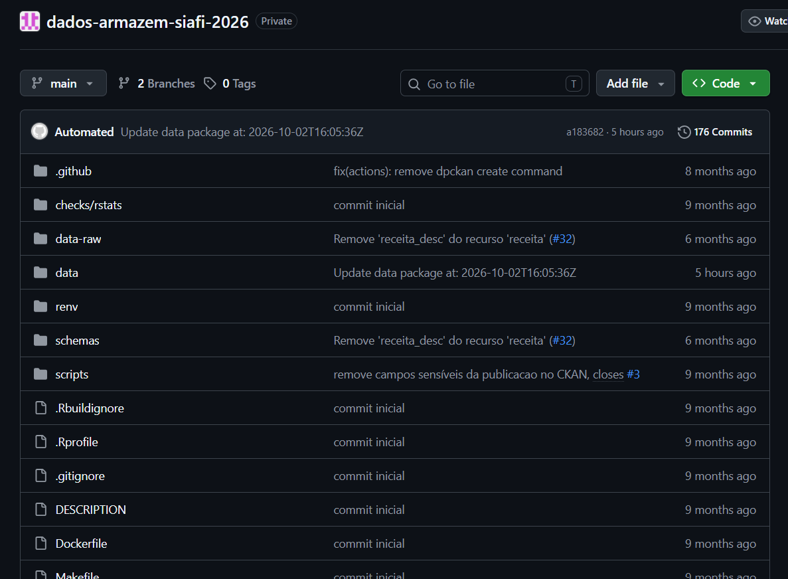
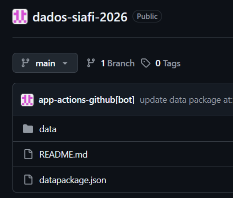
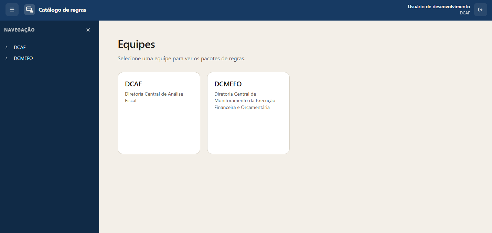
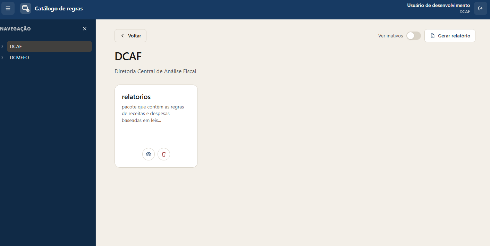
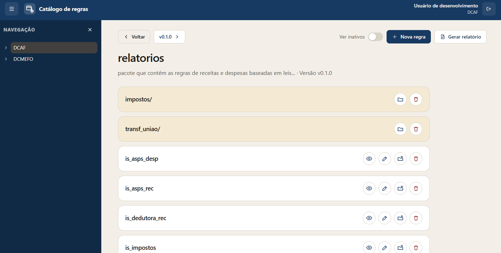
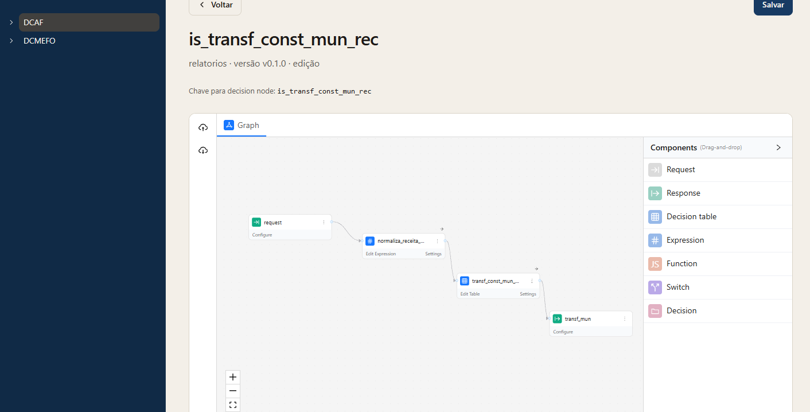
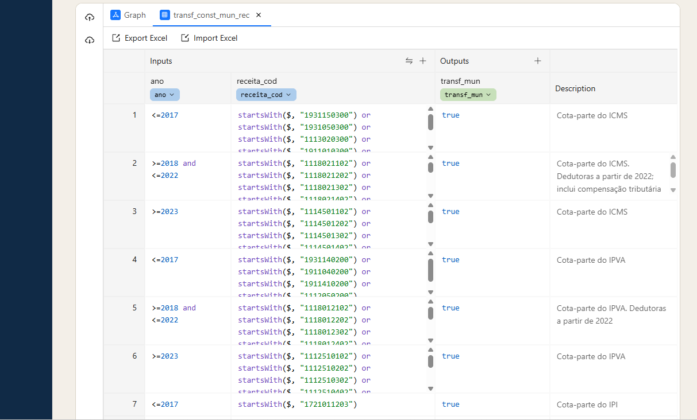

---
slides:
  title: Modernização do Processo de Produção de Dados Splor
  theme: moon
revealjs:
  width: 1920
  height: 1080
---

<style>
.reveal pre code { max-height: 900px; white-space: pre-wrap !important; overflow-wrap: anywhere; }
</style>

<div class="r-hstack" style="align-items:flex-start; gap:80px">
<div style="flex:1">

## De um [processo fragmentado]() para uma [estrutura padronizada de dados]()
---

- **Em 2026, avançamos na modernização do nosso processo de preparação de dados, integrando a extração, a transformação e a organização das informações em uma estrutura comum, documentada e reutilizável.**

- **O resultado esperado é [reduzir a complexidade da manutenção](), [diminuir etapas intermediárias](), [facilitar a continuidade do trabalho]() e [criar uma base mais consistente para a produção de painéis e relatórios de análise orçamentária]().**

<!--s-->

## Guia de Sobrevivência Aid

- Respositório
- Datapackage
- CLI

[](https://mermaid.live/edit#pako:eNpNkcFu2zAMhl9F4NkJPE92XF3Ty4AWA4adZu_AWowjpBY9Si66BnmqPcJebIqdGQFE4Cd__B8l6AwdWwIDm82mldZ37A-uN1ep1An9C_q5udnLZHG_0cjBxb9_xHFz3_xcfKUsd6H56i0plh69-8CBg0oH5dfk3pJIjjq6MOc6TgEVBV_w9cjbG-URI47YnbCn5k6vO4QSX0iaPQ8JQKETeqNhZo9ohe_WWrQc_oP3T1-aVCtoRAkk3ynEcGPNsY4H9Cl29VHRO3VTRFGp6IArDDLoxVkwB3wNlMFAMuC1h_PVbiEeaaAWTJIW5dRC6y8pNKL_wTyAiTKlmPDUH1fINFqM9OiwFxzW6fLgPU8-gqnLTxmQdZHlefnH-TtnMJgzvIPZPOitLou6qqqHMt8VusjgN5idrrd5rnefy1rruq7LSwYf81Xyba1LnRdVlSeRV3lx-Qepxrol)

<!--v-->

## Repositório

- Pasta de arquivos
- Qualquer tipo de arquivo: scripts, dados, imagens, pdf, etc.
- Possui histórico (git).
- Está na nuvem (Github).

<!--v-->

## Data package
- Ficha técnica que acompanha os dados (planilha ou conjunto de dados).
- [Frictioneless](https://frictionlessdata.io/): padroniza a descrição dos campos, formatos, arquivos e propriedades.
- Essa padronização permite que diferentes bases sejam descritas de uma maneira comum, facilitando sua manutenção, validação e processamento automatizado.

<!--v-->
<div class="r-hstack" style="align-items:flex-start; gap:80px">
<div style="flex:1">

```yaml
{
  "name": "dados-armazem-siafi-2026",
  "title": "Sistema Integrado de Administração Financeira – SIAFI 2026",
  "profile": "tabular-data-package",
  "resources": [
    {
      "name": "execucao",
      "type": "table",
      "title": "execucao",
      "profile": "tabular-data-resource",
      "path": "data/execucao.csv.gz",
      "scheme": "file",
      "format": "csv",
      "mediatype": "text/csv",
      "compression": "gz",
      "encoding": "utf-8",
      "hash": "sha256:086e40c05af96c817d6c996fac4558990447beecf35d3df51798bd72ea7001fd",
      "bytes": 24790377,
      "fields": 30,
      "rows": 914729,
      "schema": {
        "fields": [
          {
            "name": "ano",
            "type": "integer",
            "source": "Ano de Exercício"
          },
          {
            "name": "uo_cod",
            "type": "integer",
            "source": "Unidade Orçamentária - Código"
          },
          {
            "name": "ue_cod",
            "type": "integer",
            "source": "Unidade Executora - Código"
          },
        ]
      }
    }
  ]
}
```

<!--v-->

## CLI

- _Command-Line Interface_: É uma forma de interagir com um programa por meio de comandos e argumentos digitados em um terminal.
- A ferramenta executa a tarefa solicitada por escrito em vez de navegar por botões, menus e cliques.
- Permite transformar uma tarefa em uma operação padronizada e repetível, que pode ser executada por uma pessoa ou por uma máquina e, por isso, incorporada a um fluxo automatizado.

<!--s-->

<div class="r-hstack" style="align-items:flex-start; gap:80px">
<div style="flex:1">

### Antes

**Extração de relatórios no BO**

_(Rotinas distribuídas em vários repositórios)_

[↓]()

**Envio por e-mail**

_(Recebimento e divisão dos arquivos)_

[↓]()

**Scripts em R e Python**

_(Preparação e transformação dos dados)_

[↓]()

**QlikView**

_(Carga e utilização nos painéis e relatórios)_

</div>
<div style="flex:1">

### Depois

**BOCLI**

_(Download direto de dados, sem o intermediários)_

[↓]()

**Dados-orcamentarios**

_(Descrição padronizada dos conjuntos de dados)_

[↓]()

**Dpetl + Linktable + Zendt**

_(Transformaçâo e aplicação de regras orçamentárias)_

[↓]()

**Datamart**

(Banco de Dados Orçamentários)

[↓]()

**Ferramenta de visualização de dados**

_(Painéis e relatórios)_

</div>
</div>
<!--s-->

## BOCLI

Desenvolvido pela equipe da AID para acessar os dados do SAP BusinessObjects diretamente por meio de sua API REST.

- Download direto dos dados pelo terminal.
- Eliminação do envio por e-mail e da divisão dos arquivos.
- Fluxo de extração mais simples e direto, com menos dependências.

**Menos etapas operacionais e uma extração de dados mais simples de automatizar e manter.**

<!--s-->
## dados-orcamentarios

Um repositório central que organiza os metadados dos dados e coordena a execução automatizada do processo de ETL.

- Centraliza os *datapackages*, permitindo consultar as descrições dos dados.
- Organiza schemas, scripts e workflows do processamento.
- Utiliza o Dpetl para executar as etapas de extração, transformação e carga.
- Executa o fluxo diariamente por meio do GitHub Actions, sem necessidade de iniciar cada execução manualmente.

**Processo mais organizado, padronizado e automatizado, com execução diária e menor dependência de intervenções manuais.**

<!--v-->
<div class="r-hstack" style="align-items:flex-start; gap:80px">
<div style="flex:1">

- O repositório do datapackage contém
  - dados brutos
  - dados processados
  - schemas
  - scripts
  - workflow
  - descriptor



</div>
<div style="flex:1">

- Repositório [dados-orcamentarios](https://github.com/splor-mg/dados-orcamentarios):
  - schemas
  - scripts
  - workflow

- Repositório do datapackage:
  - dados processados
  - descriptor (datapackage.json)



</div>
</div>

<!--s-->
## Dpetl

[Biblioteca](https://pypi.org/project/dpetl/) desenvolvida pela equipe da AID para executar as etapas de extração, transformação e carga de dados de forma padronizada e reutilizável.


[Um fluxo comum de processamento]()
- **Extrair:** obter dados de diferentes fontes e por diferentes métodos.
- **Transformar:** padronizar arquivos e metadados, aplicar anonimização e validações quando necessárias.
- **Carregar:** publicar os dados processados e suas descrições nos repositórios de destino.

[Evolução das capacidades]()
- Integração da *linktable* para relacionar diferentes conjuntos de dados.
- Integração do *Zendt* para aplicar regras orçamentárias durante a transformação.

[↓]()

**Uma base comum para processar diferentes conjuntos de dados, incorporar regras de negócio e reduzir a necessidade de soluções específicas para cada fluxo.**


<!--s-->
## Zendt

Ferramenta desenvolvida pela equipe para aplicar regras de negócio a tabelas de dados, a exemplo das classificações orçamentárias presentes no pacote relatórios (DCAF).


[Problema]()

- Aplicação em diferentes contextos (Pacote em linguagem R);
- Manutenção exige conhecimento de programação da DCAF;
- Conhecimento “restrito” à DCAF (difícil acesso, difícil aplicação);
- Dificulta a padronização de projetos/ferramentas da SPLOR.
</div>


[Solução Encontrada]()

Criação de uma ferramenta capaz de separar *lógica de decisão* de *linguagem de programação*

<span style="color:rgb(215, 169, 245);">Simplificar</span> a criação e a aplicação de regras orçamentárias, focando também em <span style="color:rgb(215, 169, 245);">transparência</span> (acesso fácil para toda a SPLOR e, possivelmente, até para fora) e <span style="color:rgb(215, 169, 245);">legibilidade</span> (visualização das regras em linguagem natural), mantendo características importantes como <span style="color:rgb(215, 169, 245);">versionamento</span>.

**O acesso simplificado é para a regra aplicada (colunas nas bases) e para o contéudo da regra!**


<!--v-->

[Dois Produtos]()
- Zendt: ferramenta (CLI) de aplicação das regras --> responsável por entregar às bases da SPLOR as colunas com os campos orçamentários, tornando a aplicação das regras mais padronizada e reutilizável.
- Interface gráfica de criação e edição das regras --> responsável por facilitar a escrita, a compreensão e a consulta das regras [reduz a dependência da leitura e interpretação de código para entender como uma classificação é produzida].

**Representação das Regras**
- As regras são representadas em estruturas próprias [GoRules JDM --> grafos em formato de texto], em formato padronizado, em vez de ficarem embutidas em scripts de processamento.

<!--v-->
**Preview da Interface**

Cada equipe possui conjuntos ("pacotes") e cada conjunto/pacote possui regras.

<div style="display: grid; grid-template-columns: 1fr 1fr; gap: 10px; max-width: 90%; margin: 0 auto;">
  <div>
    
  </div>
  <div>
    
  </div>
  <div>
    
  </div>
  <div>

  > Regra = qualquer informação necessária para o processo decisório, que atribui valores (classifica) linha a linha a um arquivo excel/csv*

  </div>
</div>

<!--v-->
**Visualização de uma regra**

<div style="display: grid; grid-template-columns: 1fr 1fr; gap: 10px; max-width: 90%; margin: 0 auto;">
  <div>
    Grafo
    
  </div>
  <div>
    Tabela da Regra
    
  </div>
</div>

> Destaque ao campo "description" da regra --> descrições detalhadas linha a linha que não poluem a visualização (como comentários de código) e são facilmente consultáveis

<!--s-->
## Linktable

Módulo desenvolvido em Python e integrado ao Dpetl para gerar tabelas intermediárias que permitem relacionar tabelas com diferentes níveis de detalhamento.

**O que mudou**
- A construção da linktable, antes implementada em R e mantida no ambiente do QlikView, foi incorporada à biblioteca Dpetl.
- A geração pode ocorrer dentro de um único datapackage ou entre diferentes datapackages.
- A lógica de construção fica mais acessível para manutenção e reutilização, sem depender do ambiente de visualização.

<!--v-->

<div class="r-hstack" style="align-items:flex-start; gap:80px">
<div style="flex:1">
receita

    === "Antes"

        | ano  | mês | uo    | fonte | valor  |
        | ---- | --- | ----- | ----- | ------ |
        | 2026 | 03  | 2061 | 60    | 100000 |

    === "Após a criação das chaves"

        | k_receita | valor  |
        | --------- | ------ |
        | "2026 - 03 - 2061 - 60 - null - null" | 100000 |

execucao

    === "Antes"

        | ano  | mês | uo    | ação | elemento | valor  |
        | ---- | --- | ----- | ---- | -------- | ------ |
        | 2026 | 03  | 2061 | 20RK | 339030   | 150000 |

    === "Após a criação das chaves"

        | k_execucao | valor  |
        | ---------- | ------ |
        | "2026 - 03 - 2061 - null - 20RK - 339030" | 150000 |
</div>

<div style="flex:1">
credito

    === "Antes"

        | ano  | mês | uo    | ação | valor |
        | ---- | --- | ----- | ---- | ----- |
        | 2026 | 03  | 2061 | 20RK | 80000 |

    === "Após a criação das chaves"

        | k_credito | valor |
        | --------- | ----- |
        | "2026 - 03 - 2061 - null - 20RK - null" | 80000 |
</div>
</div>
<!--v-->

*Linktable*

    === "Resultado"
      | ano  | mês | uo    | fonte | ação | elemento | k_receita         | k_execucao         | k_credito         |
      | ---- | --- | ----- | ----- | ---- | -------- | ----------------- | -----------------  | ----------------- |
      | 2026 | 03  | 2061 | 60    | null | null     | "2026 - 03 - 2061 - 60 - null - null " | null | null     |
      | 2026 | 03  | 2061 | null  | 20RK | 339030   | null | "2026 - 03 - 2061 - null  - 20RK - 339030"  | null  |
      | 2026 | 03  | 2061 | null  | 20RK | null     | null | null  | "2026 - 03 - 2061 - null - 20RK  - null"      |

** inserir link para a link funcionando **

<!--s-->

<div class="r-hstack" style="align-items:flex-start; gap:80px">
<div style="flex:1">

## Datamart

- Banco de dados que irá reunir todo o universo de dados orçamentários.
- Histórico e dados atualizados em um só lugar.

</div>
<div style="flex:1">

## Ferramenta de visualização de dados

- Ferramenta Open Source.
- Liberdade para criar relatórios e painéis.

</div>
</div>
<!--s-->
